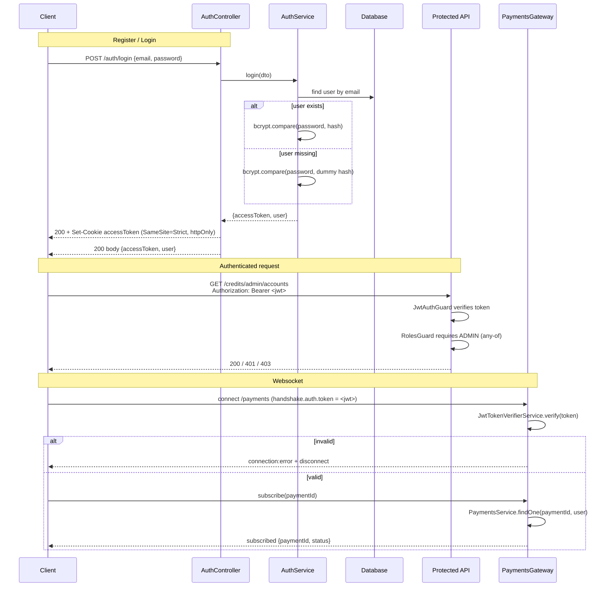

# Authentication model

How ManageHub authenticates requests and sockets: what a token is, how it is
carried, how long it lives, what roles mean, and how the payments websocket
authenticates. This file documents the code as it exists today; where the
code has a known gap it is called out explicitly.

## Tokens

`AuthService` issues a JWT signed with `JWT_SECRET` (see `auth.module.ts`).
The payload is minimal:

```json
{ "sub": "<user id>", "role": "user" | "admin" }
```

`JwtTokenVerifierService.verify` re-checks the signature and maps the payload
back to a `RequestUser` (`{ id, role }`), defaulting a missing `role` to
`USER`.

### Lifetime

The token is signed with **no `expiresIn`** (`AuthService.issueToken` calls
`signAsync` with no sign options), so the JWT itself carries no `exp` claim
and does not self-expire. Its practical lifetime is bounded only by the
`accessToken` cookie's `Max-Age` (7 days, see `AuthController`) — a bearer
client that stores the token elsewhere keeps it until `JWT_SECRET` is rotated.

> Gap: bearer tokens outlive the cookie that issued them. Rotating
> `JWT_SECRET` is currently the only way to revoke outstanding bearer tokens.

## Cookie vs bearer

`POST /auth/login` and `POST /auth/register` return the JWT in the response
body **and** set it as an `accessToken` cookie:

```
httpOnly, sameSite=strict, path=/, maxAge=7 days, secure in production
```

`JwtAuthGuard` accepts the token from either place, checking the cookie first
and falling back to `Authorization: Bearer <token>`:

1. `request.cookies.accessToken`
2. `Authorization: Bearer <token>`

> Gap: the guard reads `request.cookies`, which is populated by
> `cookie-parser`. That middleware is a dependency but is not currently
> registered in `main.ts`, so in practice only the bearer path works until
> `app.use(cookieParser())` is added. The cookie is still set/cleared by
> `POST /auth/logout`.

## Account enumeration

Login is timing-hardened (issue #1964): when the email is unknown,
`AuthService.login` still runs a bcrypt comparison against a generated
cost-12 dummy hash before returning the same `401 Invalid credentials`, so an
unknown address costs about as long as a known one with a wrong password.

Registration deliberately keeps `409 Email is already registered`
(issue #1964). The alternative — responding identically to a brand-new
sign-up — is only truthful if `/register` never issues a token at all, i.e.
if it hands off to an email-verification / "you already have an account"
notification flow, which this codebase does not have yet. Until that flow
exists, the explicit `409` is retained and the login side is hardened. This
decision is revisited here whenever the email flow lands.

## CSRF stance

The auth cookie is `SameSite=Strict`, `httpOnly`, and (in production) `secure`.
`SameSite=Strict` means the browser will not attach the cookie to any
cross-site request, which is the primary CSRF mitigation; combined with
`httpOnly` a page cannot read the token either. No separate CSRF token is
issued.

## Roles

`UserRole` has two values: `USER` and `ADMIN`. New accounts default to `USER`
(`users.role` column default). `RolesGuard` enforces role requirements:

- `@Roles(...)` declares the roles a handler accepts (on the method or class).
- The guard reads the requirement via `Reflector`; if none is set, the route
  is open to any authenticated user.
- Matching is **any-of**: the request is allowed if the user's role appears in
  the declared list (`requiredRoles.includes(request.user?.role)`). With the
  current two-value enum this is equivalent to equality, but the guard is
  written so adding a third role requires no change to existing handlers.

## Socket authentication

The payments gateway (`PaymentsGateway`, namespace `/payments`) authenticates
in the Socket.IO handshake, not with a Nest guard. On `handleConnection` it
reads the token from `client.handshake.auth.token`, verifies it with the same
`JwtTokenVerifierService`, and stores the user on `client.data.user`. A
missing or invalid token emits `connection:error` and disconnects the socket.
Each `subscribe` message re-checks access via `PaymentsService.findOne`, so a
socket can only join a room for a payment it is allowed to see.

## Admin bootstrap

There is no self-serve admin promotion. `role` defaults to `USER`; an admin is
created by an operator directly, e.g.:

```sql
UPDATE users SET role = 'admin' WHERE email = 'you@example.com';
```

or by seeding a user with `role = 'admin'` (see `backend/scripts/demo-data.js`).
After changing the role, the user must log in again so a fresh JWT carries the
new `role` claim (the token embeds the role at issue time).

## Sequence diagram


